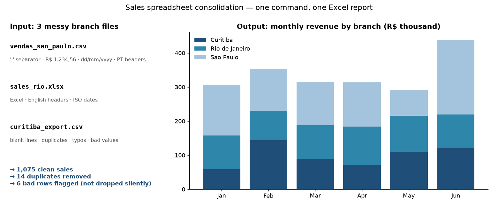

# Sales Spreadsheet Consolidation

Turns messy spreadsheets from different sources into **one clean, formatted Excel report** with a single command. Ideal for businesses that waste hours every week copying and fixing data by hand.



## The problem

Each branch (or system, or employee) exports data its own way:

| File | Quirks |
|---|---|
| `vendas_sao_paulo.csv` | `;` separator, `R$ 1.234,56` money, `dd/mm/yyyy` dates, Portuguese headers |
| `sales_rio.xlsx` | Excel, English headers, ISO dates |
| `curitiba_export.csv` | blank lines, re-exported duplicates, inconsistent casing/spaces, missing and invalid values |

## The solution

`consolidate.py` automatically:

1. **Reads every .csv/.xlsx** in a folder and detects separators.
2. **Maps different column names** to one standard schema (`Data`/`Sale Date`/`dt_venda` → `date`, etc.), accent- and case-insensitive.
3. **Parses Brazilian and US number/date formats** (`R$ 1.234,56`, `1,234.56`, `31/01/2026`, `2026-01-31`).
4. **Normalizes text** and **removes duplicates**.
5. **Never drops data silently:** every rejected row goes to an *Issues* sheet with the file, row number and reason.
6. Writes a formatted **Excel report**:
   - **Summary:** KPIs plus monthly revenue by branch, with a native Excel chart.
   - **Top products:** revenue and units per product.
   - **Clean data:** standardized, deduplicated rows with filters.
   - **Issues:** what was rejected and why.

**Demo result:** 3 files, 1,095 raw rows → **1,075 clean sales**, 14 duplicates removed, 6 bad rows flagged.

> The demo data is **synthetic**, generated by `generate_sample_data.py`.
> 📎 See the finished report without running anything: [`example/sales_report_example.xlsx`](example/sales_report_example.xlsx)

## Run it

```bash
pip install -r requirements.txt
python -m pytest -q                # 13 unit tests
python generate_sample_data.py     # creates input/ with messy demo files
python consolidate.py --input input --output report/sales_report.xlsx
python make_preview.py             # regenerate the image above
```

Can run on a schedule (Windows Task Scheduler / cron) so the report is ready every morning.

## Need something similar?

Reports, reconciliations, spreadsheet clean-up, data entry automation. Send me a sample of your files and what you need at the end.
